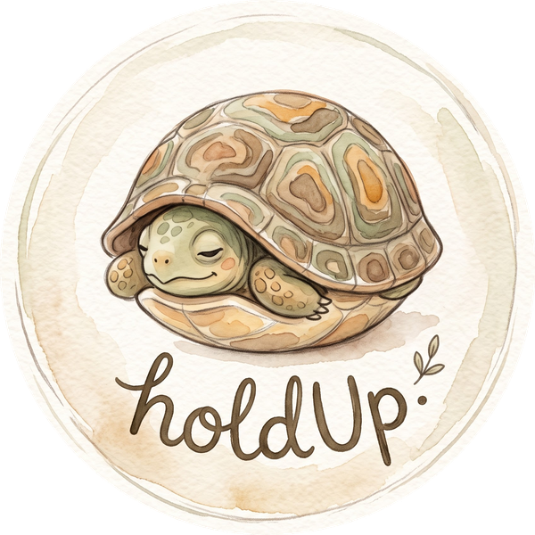

<p align="center">
  
</p>

<h1 align="center">HoldUp</h1>

<p align="center">
  <b>Pause before you scroll. Mindful friction for healthier digital habits.</b>
</p>

<p align="center">
  <a href="https://sneakyzippy.github.io/HoldUp/"></a>
  <a href="https://github.com/SneakyZippy/HoldUp/releases"></a>
  <a href="LICENSE"></a>
  
</p>

---

HoldUp intercepts doomscroll apps (Instagram, TikTok, YouTube, Reddit, etc.) with a mindful pause instead of a frustrating hard block. Break autopilot muscle memory and regain conscious control of your screen time.

## How it works

When you open a monitored app, HoldUp pauses you with a mindful intervention:

- **Sacred Lotus Breathwork**: Guided 3-phase breath cycle (Inhale, Hold, Exhale) with sacred geometry bloom, breathing halo, and tactile haptics.
- **Mindful Reflections**: Curated grounding prompts and reality checks (with hide/downvote and custom quotes).
- **Personal Anchor**: Photo of a loved one or video message from a friend.
- **Healthy Swaps**: Quick ideas of rewarding things to do instead.
- **Mindful Accent Themes**: 5 curated OLED atmospheres (Zen Sage, Mindful Iris, Glacier Blue, Golden Sunset, Sakura Rose).
- **Zen Spirit Sanctuary (Zoo)**: Adopt and evolve 6 procedural spirit companions (*Moss Turtle*, *Ember Fox*, *Cloud Owl*, *Lotus Axolotl*, *Bamboo Panda*, *Cosmic Koi*) across 4 stages (*Spirit Egg* → *Hatchling* → *Juvenile* → *Awakened*) using spendable mindful points.

Choose to **Walk Away** (+10 pts, up to 3×/day) to log a mindful win and return home, choose a **Healthy Swap** to redirect your energy, or open the app mindfully for a custom session (**1–60 min**, quick presets **2, 5, 10, 15, 30 min**). When your time expires, a soft nudge brings you back to reality.

## Minimalist Bento Dashboard, Daily Grace & Focus Tiers

Track your journey without visual clutter:
- **Mindful Intention Dial**: Instant visual feedback on today's conscious win rate and estimated minutes saved.
- **Daily Grace Budget & Streaks**: Choose a daily grace budget (`Off (0m)` up to `1h`) with scaled multipliers (`0.4×`–`2.0×`), build consecutive clean days, and protect streaks with **Streak Freezes** (100 pts, max 2).
- **Clean Focus Hours**: Earn points automatically for every continuous hour without an over-budget interruption (e.g., **+10 pts/hr** on the balanced 15m budget, up to **+20 pts/hr** in Strict mode).
- **Daily Focus Bonus**: Earn a **Pure Zen** or **Within Grace** bonus at day rollover when staying within your daily grace budget.
- **Walk Away**: **+10 points** for mindfully stepping back when an intervention triggers (capped at 3 rewards/day).
- **Duration-Scaled Penalties & Early-Exit Refunds**: Going over your Daily Grace budget deducts points proportional to your planned session duration (plus relapse friction if reopening within 15 minutes). Leaving early automatically refunds unused grace minutes and penalty points.
- Level up through focus tiers (*Mindful Novice* → *Focus Builder* → *Focus Pro* → *Habit Champion* → *Zen Master*) and raise your Zen Spirit companion right from the dashboard.

## Download & Testing

HoldUp is currently in closed testing. If you'd like to try it out, you can download it from Google Play as a tester until it's officially released!

- 🧪 **Google Play Closed Beta**: Follow the step-by-step instructions on our [Testing Portal](https://sneakyzippy.github.io/HoldUp/) to join the tester group and install directly from Google Play.
- 📦 **Direct APK**: Download the latest release APK from [GitHub Releases](https://github.com/SneakyZippy/HoldUp/releases).

### Build from Source
```bash
./gradlew assembleDebug
```

## Permissions
- **Accessibility Service**: Detects app launches and handles navigation when you walk away.
- **Usage Access**: Displays today's screen time in the reality check banner.

## Privacy First
HoldUp processes **all data 100% locally on your device**. No accounts, no tracking, no analytics, and no external network calls.

## Contributing
Contributions, feature suggestions, and pull requests are welcome! If you find a bug or have an idea, feel free to open an issue or submit a PR.

## License
This project is open-source under the [GNU General Public License v3.0](LICENSE). You are free to inspect, modify, and contribute to the code. Any derivative work or distribution must remain open source under the same license with attribution.
